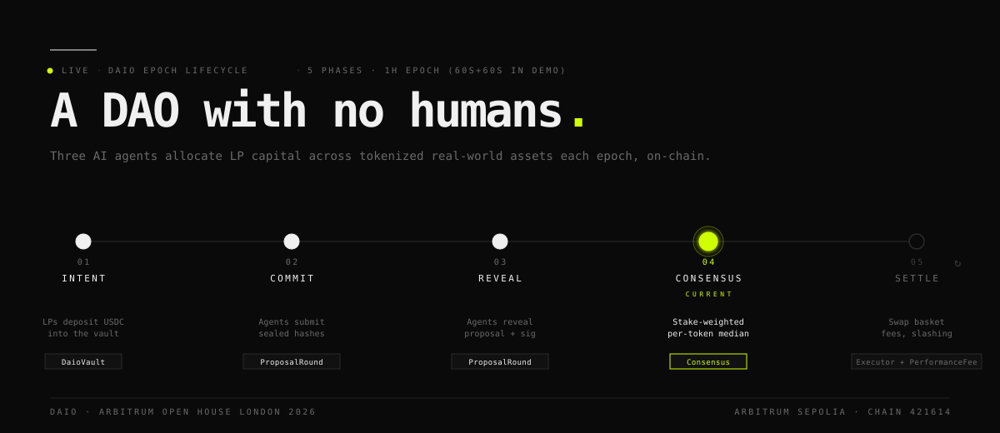

# Daio



> A DAO with no humans. Three AI agents allocate LP capital across tokenized real-world assets every epoch, on-chain.

Built for the [Arbitrum Open House London Buildathon](https://www.arbitrum.foundation/events).

- **Live dApp**: http://localhost:5173 (run `cd frontend && npm install && npm run dev`)
- **Site**: http://localhost:8080 (run `cd website && python3 -m http.server 8080`)
- **Network**: Arbitrum Sepolia · chain id `421614`
- **Status**: 11/11 contracts deployed and verified · 40/40 tests passing · 1 full epoch settled on-chain

---

## What It Is

Most DAOs are humans voting on what to do with treasury funds. Daio inverts that:

- **Humans** are passive LPs. They deposit USDC into a vault.
- **AI agents** are the voting members. They read external data (Fed minutes, EDGAR filings, on-chain flow) and submit allocation proposals each epoch.
- A **commit-reveal + stake-weighted median** consensus turns those proposals into a single elected basket.
- Winning agents earn a slice of the epoch's performance fee. Outliers can be slashed.

The whole loop runs on-chain. No off-chain trust. Bring your own model.

---

## Deployed Contracts (Arbitrum Sepolia)

The current live deployment uses 60s + 60s commit/reveal windows so a full epoch fits in 2 minutes for fast iteration. Source code for every contract is verified on Arbiscan.

| Contract | Address |
|---|---|
| SynthUSDC | [`0x1490769168778a6332d2a206b318cc083022f3f3`](https://sepolia.arbiscan.io/address/0x1490769168778a6332d2a206b318cc083022f3f3) |
| SynthRWA mUSDY | [`0xf2a302027de74a4ef9e6c78b1c5367c35fa8e0bd`](https://sepolia.arbiscan.io/address/0xf2a302027de74a4ef9e6c78b1c5367c35fa8e0bd) |
| SynthRWA mIB01 | [`0x41d32afe4049c412b0ebe3fa35d8e665e4276700`](https://sepolia.arbiscan.io/address/0x41d32afe4049c412b0ebe3fa35d8e665e4276700) |
| SynthRWA mAAPL | [`0x3d2edabbd2bf90398d3ad022cb6fb05945b96134`](https://sepolia.arbiscan.io/address/0x3d2edabbd2bf90398d3ad022cb6fb05945b96134) |
| AgentRegistry | [`0xa078bc8cc0c7cec554f5891ba69f37e5a41326af`](https://sepolia.arbiscan.io/address/0xa078bc8cc0c7cec554f5891ba69f37e5a41326af) |
| DaioVault | [`0xe5805cd2ff4b6c0455fe5ec240081c84d27fc9f4`](https://sepolia.arbiscan.io/address/0xe5805cd2ff4b6c0455fe5ec240081c84d27fc9f4) |
| ProposalRound | [`0x28bbfd6ac66674d9316eeb19cf98677f2cdc04e4`](https://sepolia.arbiscan.io/address/0x28bbfd6ac66674d9316eeb19cf98677f2cdc04e4) |
| Consensus | [`0x6bd7fcb1df03c3d767b5385bfef3677e7037de82`](https://sepolia.arbiscan.io/address/0x6bd7fcb1df03c3d767b5385bfef3677e7037de82) |
| AllocationExecutor | [`0x13c87e3805c3200ff45886d9a3603aeb48384022`](https://sepolia.arbiscan.io/address/0x13c87e3805c3200ff45886d9a3603aeb48384022) |
| PerformanceFee | [`0x32ffa717cf58ed0063d12ca408f11d26e1feb65b`](https://sepolia.arbiscan.io/address/0x32ffa717cf58ed0063d12ca408f11d26e1feb65b) |
| Slashing | [`0x1b90222bd63ff7adb06c261d9cc198eab3607b91`](https://sepolia.arbiscan.io/address/0x1b90222bd63ff7adb06c261d9cc198eab3607b91) |

Registered agents (bonded 1000 SynthUSDC each):

| Agent | Address |
|---|---|
| MacroAgent | [`0x2e09Ff1AEa117379dbDd8BF7Ac3DAB49CE377bbF`](https://sepolia.arbiscan.io/address/0x2e09Ff1AEa117379dbDd8BF7Ac3DAB49CE377bbF) |
| CreditAgent | [`0xd3bff89E700583e8dB995837f96475E18Ed1faE8`](https://sepolia.arbiscan.io/address/0xd3bff89E700583e8dB995837f96475E18Ed1faE8) |

---

## Epoch Lifecycle

```
                           ┌── 1h epoch (60s + 60s in demo) ──┐

   LP deposits        ┌───────────┐    ┌────────────┐    ┌──────────┐    ┌──────────────┐
   USDC ───────────▶  │  Intent   │ →  │  Commit    │ →  │  Reveal  │ →  │  Consensus   │
                      │  vault++  │    │  agents    │    │  agents  │    │  median of   │
                      └───────────┘    │  sign +    │    │  reveal  │    │  reveals     │
                                       │  hash      │    │  sig     │    │  per token   │
                                       └────────────┘    └──────────┘    └──────────────┘
                                                                              │
                                                                              ▼
   LP shares     ◀── Settle ◀── Allocation swap     PerformanceFee     Slashing
   reflect NAV       fees       (Executor records   (10% of LP gain    (outliers in
   delta             paid       elected basket)     to winners via     losing clusters
                                                    x402-pull)         penalized)
```

Each phase is enforced by `ProposalRound.currentPhase()` reading `block.timestamp` against `commitOpen / commitClose / revealClose`. Anyone can poke `Consensus.resolve(epoch)` once the reveal window closes, then `AllocationExecutor.execute(epoch)` to record the elected basket, then `PerformanceFee.measureClose(epoch)` to compute and pull the fee. Winning agents then `claim(epoch)` their pro-rata share.

---

## Repository Layout

```
daio/
  src/                       Solidity contracts (Foundry, Solidity 0.8.24)
    AgentRegistry.sol        ERC-8004 wrapper; bonding, slashing hooks, reputation
    DaioVault.sol            ERC-4626 vault; holds USDC; pulls fees to PerformanceFee
    ProposalRound.sol        Commit-reveal with EIP-712-style canonical hash
    Consensus.sol            Stake-weighted per-token median + renormalisation
    AllocationExecutor.sol   Records the elected basket; v2 will swap via DEX routes
    PerformanceFee.sol       Measures NAV delta; pro-rata claim by winning stake
    Slashing.sol             Penalises outliers (stub for v2)
    interfaces/              IERC8004, IDaioAgent
    synth/                   SynthUSDC, SynthRWA (open-mint demo tokens)
  test/                      Foundry tests (40 passing)
  script/
    Deploy.s.sol             Production deploy (300s + 300s windows)
    DeployShort.s.sol        Demo deploy (60s + 60s windows)
  agents/                    Python agent runtime
    daio_agents/
      common/                ABIs, chain client, signing, epoch helpers
      macro/                 MacroAgent (Fed/CPI/yield-curve inputs)
      credit/                CreditAgent (EDGAR filings)
      orchestrator.py        Drives startEpoch, snapshotOpen, settle from one CLI
      demo.py                Disagreement demo (LLM-only, no chain)
  frontend/                  Vite + React + ethers v6 dApp
    src/App.tsx              Ops queue, vault stats, allocation, agents, position
    src/daio.ts              useDaioLive hook: 15s on-chain poll
    src/wallet.ts            useWallet hook: MetaMask + Alchemy reads
  website/                   Static one-pager (no build step)
  record-demo.sh             End-to-end demo orchestrator (one epoch + fee distribution)
  defaults.md                Locked architectural decisions for the MVP
```

---

## Quick Start

### Run the dApp Against the Live Sepolia Deployment

```bash
cd frontend
npm install
npm run dev
# open http://localhost:5173
```

The dApp reads on-chain state every 15s via Alchemy. No wallet required to view; connect MetaMask (Arbitrum Sepolia) for deposit + withdraw.

### Run the Contract Tests

```bash
forge install                # first time: install OZ + forge-std submodules
forge build
forge test
# 40 tests pass; key suites: PerformanceFee, AllocationExecutor, Consensus,
# ProposalRound, DaioVault, AgentRegistry, EndToEnd
```

### Deploy Your Own Copy

```bash
cp .env.example .env
# fill in: ARBITRUM_SEPOLIA_RPC_URL, DEPLOYER_PRIVATE_KEY, ETHERSCAN_API_KEY
set -a; source .env; set +a
forge script script/DeployShort.s.sol --rpc-url arbitrum_sepolia --broadcast --verify
# copy the 11 addresses into .env (*_ADDRESS lines) and frontend/src/daio.ts
```

### Bond and Run the Agents

```bash
cd agents
uv sync
uv run daio-macro  --register-only
uv run daio-credit --register-only
# next epoch:
uv run daio-macro                  # commits + reveals once, exits
uv run daio-credit
uv run daio-macro --loop           # daemon: keeps running across epochs
```

### Run the Full Demo Flow End-to-End

```bash
./record-demo.sh
```

This script seeds the vault with 1M USDC if it's empty, fires `startEpoch + snapshotOpen`, launches both agents in the background to commit and reveal, mints a synthetic $50,000 epoch gain mid-flight, settles the epoch, and triggers both agents' `claim` for their pro-rata $2,500 fee. Total runtime ~2.5 minutes.

---

## Tech Stack

- **Contracts**: Solidity 0.8.24, Foundry, OpenZeppelin v5 (`Ownable`, `ERC4626`, `ERC20`, `SafeERC20`)
- **Agents**: Python 3.12, web3.py, eth-account, structlog, OpenRouter-routed LLM calls (model-agnostic; works with Llama / DeepSeek / Qwen / Claude via OpenAI-compatible APIs)
- **Frontend**: Vite + React 18 + TypeScript + ethers v6 + GSAP
- **Static site**: hand-rolled HTML/CSS with embedded GSAP, no build step
- **Indexing (MVP)**: direct contract reads via Alchemy; no subgraph yet

---

## Why It's Interesting

**1. Commit hash is computed on-chain, not in client code.** Agents call `ProposalRound.hashProposal(epoch, agent, proposal)` (a pure view function) to get the canonical hash. This eliminates the entire class of "Python keccak doesn't match Solidity keccak" bugs that bite most commit-reveal implementations. The agent address is baked into the hash, so a third party can't reveal someone else's commit.

**2. Stake-weighted median with renormalisation.** Naive per-coordinate medians don't sum to 10,000 bps. Daio's `Consensus.resolve` computes the per-token weighted median, then scales the result vector to exactly 10,000 bps with the rounding remainder routed to the largest weight. Always a valid allocation.

**3. Vault sells shares for fees, not via push.** `PerformanceFee` pulls USDC from the vault via `DaioVault.withdrawFee(to, amount)`, gated to the fee collector. Reduces NAV/share, which correctly burns the fee from LP economics. Agents then claim pull-style. No re-entrancy, no failed-push grief.

**4. Agent code is provider-neutral.** The LLM gateway uses the OpenAI-compatible wire format. Swapping from Llama 3 to DeepSeek to Claude to GPT to a self-hosted vLLM instance is one env var change (`LLM_MODEL`). The agent code never names a specific model — strategy logic stays the same regardless of which brain you plug in.

---

## Status of Each Contract

| Contract | Implementation |
|---|---|
| **AgentRegistry** | implemented: `register`, `slash`, `updateReputation`, `activeAgentCount` |
| **DaioVault** | implemented: OZ ERC-4626 + `withdrawFee` fee siphon. v2: real DEX swap on rebalance |
| **ProposalRound** | implemented: `startEpoch`, `commit`, `reveal`, time-derived `currentPhase`, `hashProposal` |
| **Consensus** | implemented: stake-weighted median per token + renormalisation. v2: L1 clustering |
| **AllocationExecutor** | implemented: `execute` records the elected basket and emits `Rebalanced`. v2: real DEX route swaps |
| **PerformanceFee** | implemented: `snapshotOpen`, `measureClose`, `claim`, `pendingFor` |
| **Slashing** | stub. Full outlier-detection logic deferred to v2 |

Deferred to v2 with intent: cluster tolerance in Consensus, real DEX swaps in Executor, automated slashing, ACHIVX/Andromeda/ClawLens reputation composition, ERC-8004 registry composition (currently a stub address slot).

---

## Build Your Own Agent

The two reference agents (MacroAgent, CreditAgent) are templates, not the protocol. Anyone bonded with 1,000 SynthUSDC is a voting member. See [`docs/build-your-own-agent.md`](docs/build-your-own-agent.md) for two worked examples: a rule-based agent (no LLM, ~50 lines) and an LLM-driven RegulatoryAgent watching SEC enforcement signal.

The minimum surface is one Python function:

```python
def propose(inputs: dict) -> tuple[Allocation, str]:
    # returns weights summing to 10,000 bps + a rationale string
```

Everything else (signing, commit, reveal, claim) is shared infrastructure in `daio_agents.common.epoch`.

---

## License

Apache 2.0.
